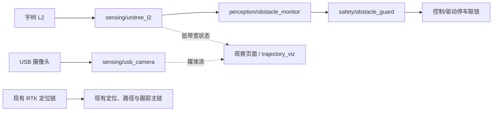

# L2 激光雷达与 USB 摄像头接入规划（草案）

> 文档性质：节点与数据流规划，供硬件接入前评审。
> 当前阶段：仅规划，不包含节点实现、硬件驱动或运行图改动。
> 当前定位基线：RTK 仍是车辆定位和导航的主要来源；L2 与 USB 摄像头首期不参与定位融合。

## 1. 目标与边界

拟接入设备：宇树 L2 激光雷达和 USB 摄像头。首期目标分为两类：

1. 为操作人员提供车辆周边的远程视觉与传感器状态观察。
2. 为后续低速避障、风险提示和停车联锁提供传感输入。

首期不把点云或图像作为 RTK 的替代定位源，也不将其送入现有路径规划和轨迹跟踪主链。以后若开展数据融合，应另立坐标系、时间同步、标定、质量评估和安全验证工作，不由本规划默认启用。

监看链路与安全链路必须分开看待：浏览器、云端连接、视频流或可视化节点不可成为停车功能的依赖。远程画面用于观察，不构成远程驾驶安全保障。

## 2. 建议的节点职责

节点名和包路径是建议命名，硬件协议和数据契约在设备到手后确认。

| 建议包路径 | 职责 | 首期输出方向 |
|---|---|---|
| `sensing/unitree_l2` | 管理 L2 连接、读取原始测量、报告设备和数据流健康 | 设备状态、时间戳、序号、驱动诊断；必要时提供点云/扫描数据给本机下游 |
| `sensing/usb_camera` | 打开指定 USB 摄像头、采集图像、报告帧率/分辨率/设备状态 | 图像流通过单独评估的媒体通道；NodeFlow 端口报告帧摘要和健康状态 |
| `perception/obstacle_monitor` | 消费 L2 数据，提取车体周边的障碍物/最近距离/危险区域等低带宽结果 | 带时间戳、有效期、来源和质量状态的障碍物摘要或风险状态 |
| `safety/obstacle_guard`（后续评审） | 按车辆运动状态和经过验证的阈值生成停车/禁止启动请求 | 明确锁存、复位、过期、故障和人工确认语义的安全请求 |
| 现有 `observability/trajectory_viz` 或云端监看端 | 汇总定位、机具、设备健康和风险状态供人观察 | 只读状态；相机媒体可由独立媒体服务提供 |

前两项属于设备接入，`obstacle_monitor` 属于感知处理，`obstacle_guard` 属于安全相关控制逻辑。分开后可以独立检查设备失联、感知失效和控制联锁的责任边界。是否需要独立节点以及具体包名，待接口设计时按实际负载和运行隔离需求决定。

## 3. 概念数据流

虚线表示观察用途的数据支路。首期 L2 到现有导航主链没有连线；摄像头也不连接定位或控制主链。障碍物联锁是后续阶段，未完成验证前不得把 `obstacle_guard` 输出接入真实车辆自动作业图。

## 4. 数据与传输原则

### L2

- 先确认 L2 实际提供的物理接口、协议/SDK、数据格式、时间戳来源、点云频率和设备状态信息，不预先假定其为 ROS、UDP 或特定点云格式。
- 驱动节点负责设备接入和原始数据完整性；障碍物算法不直接耦合设备 SDK。
- NodeFlow SharedBuffer 当前面向单写者 latest-value 快照，不提供历史队列、背压或逐帧消费保证。高带宽原始点云是否适合进入该通道，必须测量单帧大小、频率、CPU/内存和最慢订阅者影响后决定。
- 优先让原始点云在边侧处理。图和云端观察界面首期只需要设备在线状态、数据年龄、速率、故障码以及低带宽障碍物摘要；若要查看点云，再单独设计限频/降采样/本机媒体接口。

### USB 摄像头

- 设备接入节点报告设备标识、分辨率、帧率、采集时间、帧序号和错误/重连状态。
- 不把连续图像帧默认编码为普通 JSON/MsgPack 端口消息。媒体通道可以采用本机 HTTP(S) 视频端点或其他合适机制，选型要结合板端算力、网络带宽、延迟及浏览器兼容性确认。
- 状态数据和视频画面分开呈现：视频断流时显示过期/离线，不能用旧帧暗示当前环境；视频服务不参与控制器心跳或安全判断。
- 远程观看默认限制在受控局域网或经认证的访问路径。监听地址、鉴权、端口暴露和带宽策略在实际部署前确定。

### 时间与坐标

- 所有传感结果至少保留采集时间、接收时间、序号/帧号和设备健康状态；消费者按本机单调时钟计算数据年龄，并对过期数据显式降级。
- RTK、L2 和摄像头之间的时钟同步精度尚未确认。首期观测可展示各自数据年龄，不据此宣称传感器已完成时间同步。
- L2 安装外参、车辆坐标系、点云坐标方向及相机安装姿态要在硬件安装后测量并记录。没有完成标定前，不把障碍物位置投影到车辆路径坐标或作物地图。

## 5. 避障与停车的安全边界

避障不是“检测到物体就发一个零速度”这么简单。后续设计至少要处理车辆速度/转向、盲区、传感器安装位置、制动距离、地面附着、坡度、处理延迟、数据过期和传感器故障。

- 物理急停和驱动器/电气安全回路仍是最后保护层。软件停车信号不能替代独立物理急停。
- 由 L2 推导的自动停车先作为只读风险状态验证；在检测覆盖率、误报/漏报、端到端停车距离和失联行为通过实车验收前，不接真实驱动输出。
- 将来若纳入联锁，必须由本机安全相关路径处理，不能依赖云端、浏览器、视频服务或网络往返。请求需明确 `STOP`/`CLEAR` 等状态、锁存规则、复位授权、来源、时间戳和有效期。
- L2 断连、数据停止增长、时间戳异常、节点重启、输入过期或感知节点死亡时的车辆行为必须先确定并验证。不得将“无障碍物数据”解释为“前方安全”。
- 普通进程节点和通用操作系统不是经认证的功能安全控制器。要把该链路称为安全停车功能之前，需进行硬件、控制、运行时和现场安全联合评审。
- 现有异常退出安全契约指出，软件写入安全值不等于物理设备已执行；停车验收必须观测 PWM/驱动器和车辆实际运动，而不能只看 NodeFlow 端口值。

## 6. 分阶段推进

| 阶段 | 工作 | 验收出口 |
|---|---|---|
| 0. 硬件清点 | 记录 L2 和摄像头型号/固件、接口、供电、安装位置、线缆、板端算力和网络拓扑 | 获得可复现的设备接入条件；接口未知项有负责人和结论 |
| 1. 单设备采集 | 先分别验证 L2 与 USB 摄像头驱动/系统工具，记录负载、稳定性、掉线恢复和时间信息 | 长时间运行稳定；可识别断流、设备移除与重连 |
| 2. NodeFlow 只读接入 | 增加设备节点、健康状态契约和独立测试图，不连接控制主链 | `node.yaml` 契约和实际负载一致；节点退出/断流可观察 |
| 3. 远程监看 | 将 L2 摘要和摄像头媒体接到观察界面，验证局域网访问、带宽、鉴权、数据过期提示 | 断流明确显示；监看进程停止不会改变车辆控制 |
| 4. 障碍物离线评估 | 记录带标签的现场数据，评估距离/区域检测、盲区、误报漏报与延迟 | 在代表性场地形成可复核报告和阈值依据 |
| 5. 仿真与受控停车验证 | 先回放/仿真，再在车辆架空或隔离区域验证请求到真实执行器的链路 | 通过失联、节点死亡、过期输入和不同速度下的停车验收；物理急停可随时接管 |
| 6. 受限实车试运行 | 有人近距离监管、低速、限定区域运行，逐步放开适用条件 | 现场安全负责人批准运行包线、复位流程和回退方式 |

任一阶段失败都保留 RTK 主链和现有停车保护，不以关闭保护来满足传感器接入。

## 7. 硬件到手后需确认

1. L2 的准确型号/固件、数据接口、协议或官方 SDK、供电和网络配置；是否存在官方 ROS 驱动及其许可/依赖。
2. L2 可输出的数据项、点云编码/采样频率/最大报文或帧大小、时间戳语义、健康/诊断状态和连接恢复方式。
3. USB 摄像头的型号、UVC 能力、可用格式、目标分辨率/帧率、低照度表现及板端视频编码能力。
4. 两设备相对车辆、RTK 天线、机具和操作者的安装位置、视场遮挡、振动/防水防尘和线束固定。
5. 板端 USB/网口资源、CPU/内存/温度余量、供电预算与网络拓扑；远程观察者在哪个网络范围访问。
6. 希望首期看到哪些画面和状态，是否需要保存录像/点云；保存期限、存储空间和隐私要求。
7. 自动停车的适用速度、障碍物类别、最小安全距离、制动基线、人工复位方式，以及失联时的默认策略。

## 8. 与现有仓库的关系

- 当前节点清单以 [节点与预置图目录](NODES_AND_GRAPHS.md) 中已注册的 `node.yaml` 为准；本规划中的新包尚不存在。
- 现有 [实车 RTK 图](../configs/graphs/planning_with_real_rtk.yaml) 继续以 RTK 驱动、RTK 过滤、坐标变换和控制链为定位/导航主路径。
- [轨迹与三维作业观察节点](../edge/nodes/observability/trajectory_viz/README.md) 已提供只读实车观察入口，可在接口适合时扩展其状态显示；摄像头视频是否集成到该服务仍待选型。
- [运行时、SDK 与可靠性](RUNTIME_SDK_AND_RELIABILITY.md) 和 [节点异常退出安全契约草案](NodeFlow_节点异常退出安全契约_设计草案_20260901.md) 是断流、退出和物理安全动作的现有边界参考。

本文只记录当前规划，设备接口、阈值和验收结论须在实际测量后更新，不应从此草案推断硬件兼容性或安全性能。
